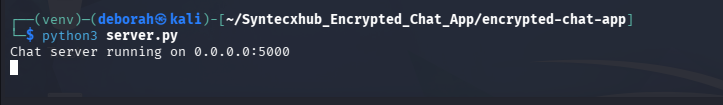
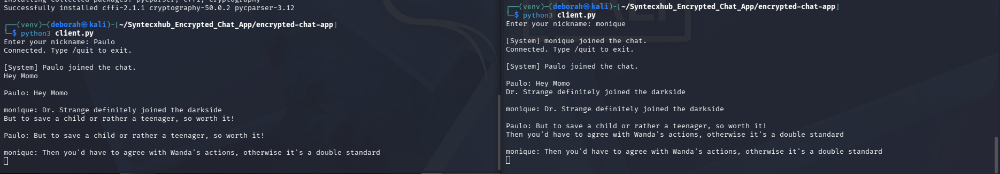
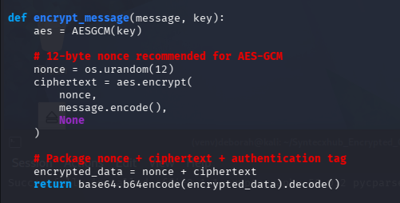
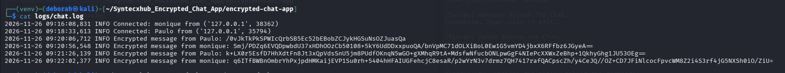
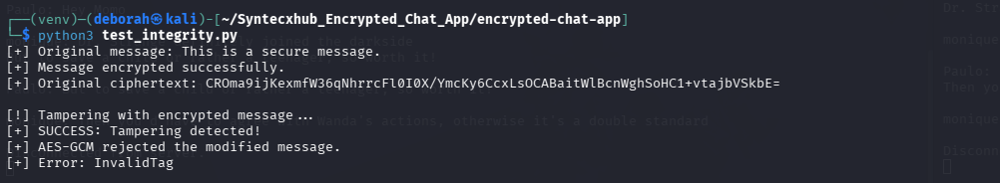

# Encrypted Chat App

**Week 2: Syntecxhub Cybersecurity Internship Project**

## Overview

This project implements a client-server chat application using Python TCP sockets and AES-256-GCM encryption to protect messages during transmission.

The objective was to understand how encrypted communication works at the application level, how cryptographic controls protect data and how to identify potential security weaknesses through testing.

I approached this project with a security operations mindset, focusing not only on getting messages from one client to another but also on confidentiality, message integrity, secure key handling, network communication and security monitoring.

The server acts as a relay between connected clients. Messages are encrypted on the client side before transmission, meaning the server handles encrypted payloads rather than plaintext messages.

## Project Objectives

- Implement TCP socket communication between clients and a central server.
- Encrypt messages before they are transmitted over the network.
- Use AES-256-GCM for confidentiality and message integrity.
- Implement pre-shared key handling.
- Generate a unique nonce for each encryption operation.
- Support multiple simultaneous clients through multithreading.
- Log server activity and encrypted message payloads.
- Test the application's response to ciphertext tampering and invalid decryption attempts.

## Technologies Used

| Technology | Purpose |
|---|---|
| Python 3 | Application development |
| Socket | TCP client-server communication |
| AES-256-GCM | Authenticated message encryption |
| Cryptography | Cryptographic operations |
| Threading | Concurrent client handling |
| JSON | Message serialization |
| Base64 | Encoding encrypted binary payloads |
| Logging | Recording server activity |
| Kali Linux | Development and testing environment |
| Git & GitHub | Version control and documentation |

## Project Structure

```text
encrypted-chat-app/
│
├── client.py
├── server.py
├── crypto_utils.py
├── generate_key.py
├── test_integrity.py
├── shared.key
├── requirements.txt
├── .gitignore
├── logs/
│   └── chat.log
│
└── evidence/
    ├── server_running.png
    ├── client_communication.png
    ├── aes_encryption.png
    ├── encrypted_logs.png
    ├── integrity_test.png
```

**Note:** `shared.key` and runtime logs are excluded from version control.

## How It Works

The application uses a central TCP server to relay encrypted messages between connected clients.

1. A client connects to the server using a TCP socket.
2. The client loads the locally stored pre-shared encryption key.
3. When a user sends a message, the client generates a fresh 12-byte nonce.
4. AES-256-GCM encrypts and authenticates the message.
5. The encrypted payload, including the nonce and authentication tag, is encoded using Base64.
6. The server receives the encrypted payload and forwards it to connected clients.
7. Receiving clients use the shared key to authenticate and decrypt the message.

The server does not need access to the encryption key to relay messages.

## Security Implementation

### 1. Confidentiality

AES-256-GCM is used to encrypt messages before they leave the client.

This reduces the exposure of plaintext messages during network transmission. Anyone intercepting the application payload should not be able to read its contents without the encryption key.

### 2. Message Integrity

AES-GCM provides authenticated encryption. It verifies the authenticity and integrity of encrypted data before returning plaintext.

I implemented an integrity test that deliberately modifies an encrypted payload before decryption.

The modified payload is rejected with an `InvalidTag` exception, demonstrating that the authentication check detects tampering.

### 3. Nonce Management

A fresh 12-byte nonce is generated using Python's cryptographically secure random generator for each encryption operation.

Nonce reuse with the same AES-GCM key can compromise security, so generating a new nonce for every message is an important security requirement.

### 4. Pre-shared Key Handling

The application uses a 32-byte pre-shared key for AES-256-GCM encryption and decryption.

The key is generated using Python's `secrets` module and stored locally.

The key is excluded from Git tracking to reduce the risk of accidental exposure through the public repository.

### 5. Concurrent Client Handling

The server uses Python threading to handle multiple client connections.

Each connected client is assigned a separate thread, allowing multiple users to communicate without requiring the server to process every connection sequentially.

### 6. Security Logging

The server records connection events, disconnections and encrypted message payloads.

From a SOC perspective, logging provides visibility into application activity and creates a starting point for investigating unusual communication patterns.

The application intentionally avoids logging plaintext messages.

## Security Testing

I performed several tests to validate the application's functionality and security controls.

| Test | Security objective | Expected result |
|---|---|---|
| Client communication | Validate TCP communication | Messages successfully delivered |
| Multiple clients | Test concurrent connections | Multiple clients communicate |
| Encryption validation | Verify message confidentiality | Server receives ciphertext |
| Integrity testing | Detect message tampering | AES-GCM rejects modified payload |
| Invalid key testing | Validate decryption failure | Authentication fails |
| Connection logging | Monitor application activity | Events recorded in server logs |

### Integrity Test

To test message integrity, I modified one byte of an encrypted payload before attempting decryption.

The receiving function rejected the modified message with an `InvalidTag` exception.

**Security observation:** An encrypted message should not automatically be trusted simply because it is unreadable. Its authenticity and integrity must also be verified before processing.

## Security Observations

While building this application, I considered several security concerns that are relevant to monitoring and incident response.

| Security concern | Potential impact | Defensive consideration |
|---|---|---|
| Key exposure | Unauthorized message decryption | Secure key storage and access control |
| Ciphertext tampering | Modified messages | Authenticated encryption |
| Replay attacks | Previously captured messages may be resent | Sequence numbers and replay detection |
| Unauthorized connections | Untrusted clients joining the chat | Client authentication |
| Excessive connections | Resource exhaustion | Connection limits and monitoring |
| Suspicious connection activity | Potential misuse of the service | Connection and event logging |

### What I Would Investigate as a SOC Analyst

If this application were deployed in a monitored environment, I would pay attention to:

- Repeated failed connections to the chat server.
- Unusual connection patterns or unexpected client activity.
- Sudden increases in connection attempts.
- Unexpected server disconnections or errors.
- Attempts to submit malformed or tampered encrypted payloads.
- Unusual traffic volumes that could indicate abuse or resource exhaustion.

These observations could be used to develop detection rules and alerting mechanisms in a SIEM platform.

## Limitations and Future Improvements

This is a learning project, not a production-ready secure messaging platform.

Some areas I would improve include:

- Implement authenticated key exchange using X25519.
- Introduce individual client identities and authentication.
- Add replay protection using authenticated sequence numbers.
- Implement TLS for transport security and server authentication.
- Introduce secure key rotation and session management.
- Add connection limits and rate limiting.
- Improve input validation and network protocol error handling.
- Integrate application logs with Wazuh or another SIEM platform.
- Develop detection rules for suspicious connection behaviour.

One important limitation is that all clients currently share the same encryption key. Any client possessing that key can decrypt messages and potentially forge messages. The current implementation also does not provide independent sender authentication or replay protection.

## Key Takeaways

This project helped me understand the relationship between network communication and cryptographic security.

I gained practical experience with TCP sockets, symmetric encryption, AES-GCM authentication, nonce generation, multithreading and security testing.

More importantly, it reinforced a defensive security principle: implementing a security control is only part of the process. It is equally important to test whether that control works, understand its limitations and identify the evidence that could help an analyst investigate suspicious activity.

## Evidence

### 1. Server Running
Demonstrates the TCP server listening for incoming client connections.


### 2. Client Communication
Shows two clients exchanging messages through the server.


### 3. AES Encryption Implementation
Highlights the AES-GCM encryption logic and nonce generation.


### 4. Encrypted Message Logging
Shows the encrypted payloads recorded by the server.


### 5. Message Integrity Testing
Demonstrates AES-GCM rejecting a deliberately modified ciphertext.

